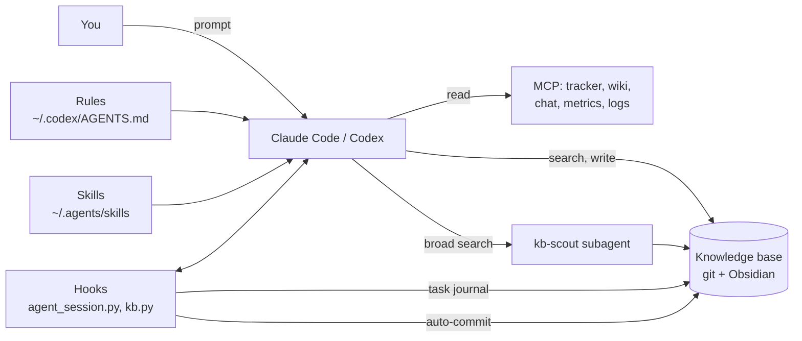

**English** · [Русский](ru/concepts.md)

# How the harness works

The harness is everything around the model that turns it into a working agent: rules, skills, tools, memory and
automation. You don't change the model; you change the harness, and the agent starts working by your rules,
finding your knowledge and keeping the context of long tasks.

## Parts

**Rules** — a single file, `~/.codex/AGENTS.md`; Codex reads it, and Claude Code pulls it in through an import from
`~/.claude/CLAUDE.md`. That way both agents behave the same. The core of the rules: remote systems are read-only,
a write requires explicit confirmation of one concrete action, infrastructure changes go through Git, secrets do
not end up in the chat or in documents, and every change in a work repository has a task key.

**Skills** — instructions for a typical task in `~/.agents/skills/<name>/SKILL.md`. The agent activates a skill on
its own when a request matches its description, or on an explicit call (`/request-triage` in Claude Code). A skill
describes the steps, what to check, which tools to use and how to finish (a document, an issue, a page). Codex
reads this directory directly; Claude Code gets symlinks in `~/.claude/skills/`.

**Knowledge base** — a Git repository that also opens as an Obsidian vault. It holds alert reviews, requests,
incidents, decisions (ADRs), reference material, task journals and short agent findings. `kb.py` searches it (BM25,
a Russian stemmer, synonyms from the glossary) and returns not whole files but sections with line numbers — the
agent reads only those. Hubs (`services/<Name>.md`, `tickets/<KEY>.md`) hold the current state of a service or task
and a list of all documents about it.

**Task journals** — `tasks/<KEY>-<slug>/handoff.md`. A long task does not fit into one chat: context gets
compacted, the chat gets closed. The journal stores the goal, current state, next step, decisions and pitfalls; a
hook injects it at the start of a new chat, and the agent picks up where it left off.

**Hooks** — commands the agent runs on events (chat start, message, tool call, end of a response, compaction).
They power the journals, context-usage reminders, injecting documents for task keys, and the knowledge-base
auto-commit. Details — [hooks.md](hooks.md).

**Subagents** — separate agents with a narrow role. `kb-scout` only reads and returns a short summary: a broad
search across a hundred files does not flood the main chat's context. For Codex there is a task orchestrator
(`coder` implements, `reviewer` independently checks) and an incident orchestrator (`incident_worker` gathers
evidence).

**Config** — `~/.config/agent-harness/config.toml`: paths, task prefixes, tracker, wiki, chat, MCP server name.
Everything that depends on the workplace lives only here. The skills and rules in the repository are written with
placeholders (`{{KB_ROOT}}`, `{{TICKET_EXAMPLE}}`), and `harness install` fills them in with values from the config.

## Principles

1. **Read by default, write on confirmation.** The agent reads and diagnoses freely; any change in the cloud,
   cluster, tracker or chat happens only after your "yes" to that one action.
2. **Knowledge lives in the base, not in the chat.** The chat will end, the document will stay. An alert review
   ends with a file in the knowledge base, a long task with a journal.
3. **The agent searches before it digs.** Before an expensive log and metrics dive — a knowledge-base search: this
   may have happened before.
4. **Context is a resource.** Narrow queries, summaries instead of raw data, broad searches go to a subagent, long
   tasks get a journal and `/compact`.
5. **One folder for all chats.** A task is told apart not by the folder but by the chat: the task key in the first
   message binds the journal. This makes it easy to run several chats in parallel.
6. **Portability.** Nothing organization-specific in the repository; moving means a new config and `install`.
