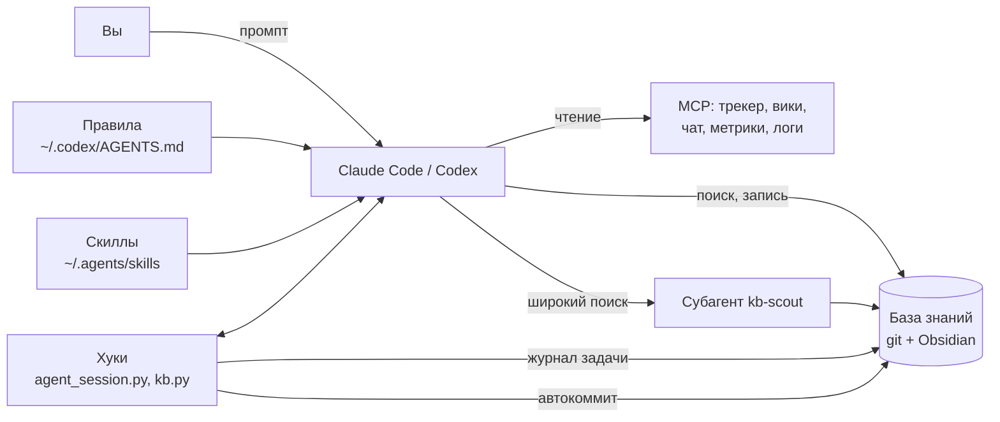

# Как устроен harness

Harness — всё, что окружает модель и превращает её в рабочего агента: правила, скиллы, инструменты, память и
автоматика. Модель вы не меняете; меняете обвязку, и агент начинает работать по вашим правилам, находить ваши
знания и не терять контекст длинных задач.

## Части

**Правила** — один файл `~/.codex/AGENTS.md`, его читает Codex, а Claude Code подключает импортом из
`~/.claude/CLAUDE.md`. Так оба агента ведут себя одинаково. Главное в правилах: удалённые системы только читаются,
запись требует явного подтверждения одного конкретного действия, изменения инфраструктуры идут через Git, секреты не
попадают в чат и документы, у каждой правки в рабочем репозитории есть ключ задачи.

**Скиллы** — инструкции под типовую задачу в `~/.agents/skills/<имя>/SKILL.md`. Агент включает скилл сам, когда
просьба совпадает с описанием, или по явному вызову (`/request-triage` в Claude Code). Скилл описывает шаги, что
проверить, какие инструменты взять и чем закончить (документ, задача, страница). Codex читает этот каталог
напрямую, у Claude Code — симлинки в `~/.claude/skills/`.

**База знаний** — git-репозиторий, который одновременно открывается как Obsidian vault. В ней разборы алертов,
обращения, инциденты, решения (ADR), справка, журналы задач и короткие находки агентов. `kb.py` ищет по ней (BM25,
русский стеммер, синонимы из глоссария) и выдаёт не файлы целиком, а разделы с номерами строк — агент читает только
их. Хабы (`services/<Имя>.md`, `tickets/<KEY>.md`) держат текущее состояние сервиса или задачи и список всех
документов о нём.

**Журналы задач** — `tasks/<KEY>-<slug>/handoff.md`. Длинная задача не помещается в один чат: контекст сжимается,
чат закрывается. Журнал хранит цель, текущее состояние, следующий шаг, решения и грабли; хук подставляет его в
начало нового чата, и агент продолжает с места остановки.

**Хуки** — команды, которые агент вызывает на событиях (начало чата, сообщение, вызов инструмента, конец ответа,
сжатие). Через них работают журналы, напоминания о заполнении контекста, подмешивание документов по ключам задач и
автокоммит базы знаний. Подробно — [hooks.md](hooks.md).

**Субагенты** — отдельные агенты с узкой ролью. `kb-scout` только читает и возвращает короткую сводку: широкий поиск
по сотне файлов не забивает контекст основного чата. Для Codex есть оркестратор задач (`coder` реализует,
`reviewer` независимо проверяет) и инцидентов (`incident_worker` собирает доказательства).

**Конфиг** — `~/.config/agent-harness/config.toml`: пути, префиксы задач, трекер, вики, чат, имя MCP-сервера.
Всё, что зависит от места работы, — только здесь. Скиллы и правила в репозитории написаны с подстановками
(`{{KB_ROOT}}`, `{{TICKET_EXAMPLE}}`), `harness install` заполняет их значениями из конфига.

## Принципы

1. **Чтение по умолчанию, запись по подтверждению.** Агент свободно читает и диагностирует; любое изменение в
   облаке, кластере, трекере или чате — только после вашего «да» на одно действие.
2. **Знание живёт в базе, а не в чате.** Чат закончится, документ останется. Разбор алерта заканчивается файлом в
   базе, длинная задача — журналом.
3. **Агент ищет раньше, чем копает.** Перед дорогим разбором логов и метрик — поиск по базе: возможно, это уже было.
4. **Контекст — ресурс.** Узкие запросы, сводки вместо сырых данных, широкий поиск — субагенту, длинная задача —
   журнал и `/compact`.
5. **Одна папка для всех чатов.** Задачу различает не папка, а чат: ключ задачи в первом сообщении привязывает
   журнал. Так удобно вести несколько чатов параллельно.
6. **Переносимость.** Ничего специфичного для организации в репозитории; переезд — новый конфиг и `install`.
